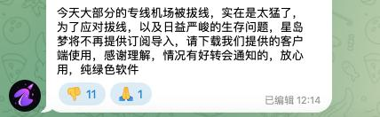
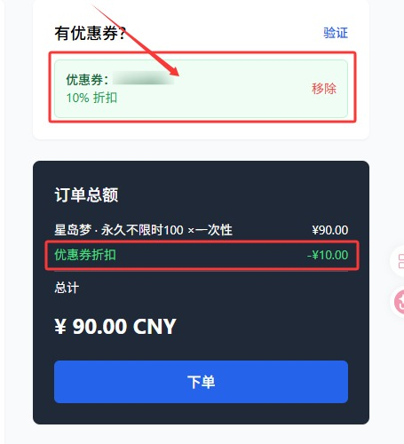
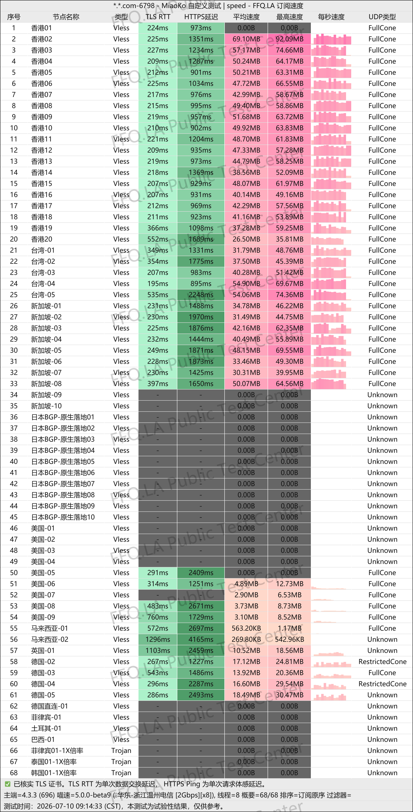
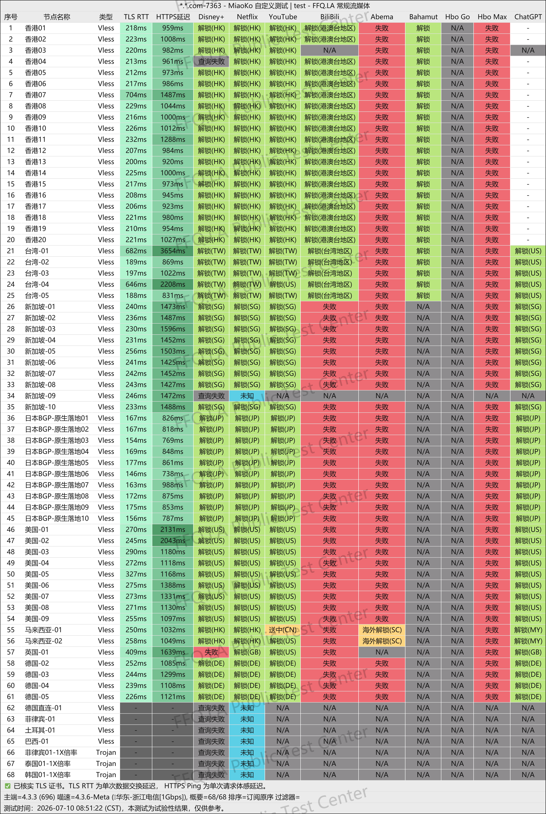
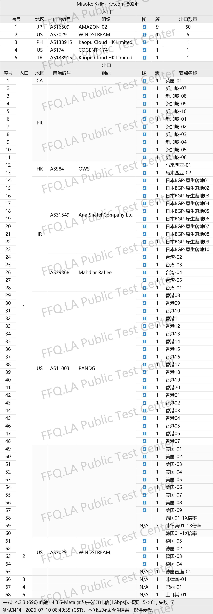

🇨🇳 [中文](README.md) | 🇺🇸 English | 🇷🇺 [Русский](README_RU.md) | 🇮🇷 [فارسی](README_FA.md)

# XingDaoMeng VPN Official Website (Updated November 5, 2026)

XingDaoMeng VPN Official Website<br>
Latest Address 01: [awasdfeqr.xdmttt4.click](https://to.iix.im/xmd03)<br>
Latest Address 02: [wuyou202001.xdmvipaff.cc](https://to.iix.im/xdm02)<br>
Official Website: [vip.xingdaomeng.com](https://to.iix.im/xdm01)<br>

2026 Best VPN Recommendations and Proxy Node Sharing: [https://github.com/jdnei/JiChangTuiJian](https://github.com/jdnei/JiChangTuiJian)<br>

## Telegram VPN Community #AD

[VPN Giveaway Group](https://331024.de/archives/choujiang) | [VPN Chat Group](https://331024.de/archives/choujiang) | [VPN Trial Group](https://331024.de/archives/choujiang)<br>

[https://331024.de/archives/choujiang](https://331024.de/archives/choujiang)

## Latest Announcement

---



---

## Invitation Code

`Register using this invitation code to become eligible for orders with the discount code.`

```bash
1snzCgTe
```

## Coupon Code / Discount Code

`10% OFF`

```bash
nmw888
```



## Introduction

XingDaoMeng VPN is an affordable premium proxy service focused on streaming platform unblocking.

It combines high-quality transit connections with IPLC dedicated lines, emphasizing low latency and connection stability.

The service offers flexible subscription plans without device limits. Its nodes support access to Netflix, Disney+, ChatGPT, and other popular services, making it suitable for streaming entertainment and everyday remote work.

## Advantages

**Advanced Network Infrastructure:** Uses the latest VLESS protocol and enterprise-grade IEPL private network connections, with optimized routes for China Telecom, China Unicom, and China Mobile.

Intelligent load balancing automatically selects suitable network routes according to the user's local internet environment.<br>

**Streaming Platform Unblocking:** All network routes support popular streaming services, including Netflix, Disney+, HBO, and YouTube. The service is designed to maintain stable connections without speed throttling during evening peak hours and supports smooth 4K playback.<br>

**AI and Social Media Access:** Supports AI tools such as ChatGPT and Gemini, as well as international TikTok video streaming and live broadcasting.<br>

**Extensive Global Coverage:** Offers more than 80 nodes in multiple regions, including Hong Kong, Taiwan, Japan, Singapore, the United States, South Korea, Malaysia, Thailand, Indonesia, the Philippines, Vietnam, the United Kingdom, Germany, France, Turkey, Brazil, and Argentina.<br>

**Multi-Platform Compatibility:** Supports iOS, Android, Windows, routers, and simultaneous connections across multiple devices.<br>

**Popular Proxy Clients:** Compatible with Shadowrocket, Clash, v2rayN, v2rayNG, Surge, Quantumult X, Stash, and other popular proxy applications.<br>

**Custom Enterprise Connections:** Provides dedicated network configurations for business users and specialized applications.<br>

**Customer Assistance:** Offers human customer support to help beginners configure and use the service.<br>

**Custom Management Panel:** Features an independently developed management panel designed for simple configuration and convenient operation.<br>

## Subscription Plans

| Plan | Price | Billing / Type | Monthly / Total Traffic | Traffic Policy | Network Bandwidth | Unblocking Support | Concurrent Devices | Node Coverage | Additional Features / Rules |
|---|---:|---|---|---|---|---|---|---|---|
| **Starter Annual Plan** | ¥96.00 | Annual | 60 GB/month | All nodes use a 1× traffic multiplier; no evening peak-hour throttling; automatically resets every 30 days | Full IPLC dedicated lines with low latency; peak speed up to 2.5 Gbps per node | Native IPs; supports Netflix, Disney+, ChatGPT, TikTok, etc. | Unlimited simultaneous clients | Hong Kong ×20, Taiwan ×10, Japan ×10, Singapore ×10, USA ×10, South Korea ×2, Argentina ×2, plus Malaysia, Vietnam, the Philippines, Thailand, India, Germany, France, the UK, etc. | Suitable for beginners and light users; approximately ¥8/month when billed annually; responsive customer support |
| **Extra 150 GB** | ¥25.00 | Monthly | 150 GB/month | All nodes use a 1× traffic multiplier; no evening peak-hour throttling; automatically resets every 30 days | Full IEPL dedicated lines with low latency; peak speed up to 2.5 Gbps per node | Native IPs; supports Netflix, Disney+, ChatGPT, and TikTok | Unlimited simultaneous devices, including computers, smartphones, and routers | Hong Kong ×20, Taiwan ×5, Japan ×10, Singapore ×10, USA ×10, Malaysia ×2, plus the UK, France, Germany, Turkey, Thailand, Brazil, etc. | Intelligent route selection; 20% OFF annual plans, 30% OFF two-year plans, 40% OFF three-year plans |
| **Advanced 300 GB** | ¥50.00 | Monthly | 300 GB/month | All nodes use a 1× traffic multiplier; no evening peak-hour throttling; automatically resets every 30 days | Full IEPL dedicated lines with low latency; peak speed up to 2.5 Gbps per node | Native IPs; supports Netflix, Disney+, ChatGPT, and TikTok | Unlimited simultaneous devices, including computers, smartphones, and routers | Hong Kong ×20, Taiwan ×5, Japan ×10, Singapore ×10, USA ×10, Malaysia ×2, plus the UK, France, Germany, Turkey, Thailand, Brazil, etc. | Intelligent route selection; 20% OFF annual plans, 30% OFF two-year plans, 40% OFF three-year plans |
| **Flash 500 GB** | ¥70.00 | Monthly | 500 GB/month | All nodes use a 1× traffic multiplier; no evening peak-hour throttling; automatically resets every 30 days | Full IEPL dedicated lines with low latency; peak speed up to 2.5 Gbps per node | Native IPs; supports Netflix, Disney+, ChatGPT, and TikTok | Unlimited simultaneous devices, including computers, smartphones, and routers | Hong Kong ×20, Taiwan ×5, Japan ×10, Singapore ×10, USA ×10, Malaysia ×2, plus the UK, France, Germany, Turkey, Thailand, Brazil, etc. | Intelligent route selection; 20% OFF annual plans, 30% OFF two-year plans, 40% OFF three-year plans |
| **Flagship 1 TB** | ¥130.00 | Monthly | 1.0 TB/month | 1000 GB/month of high-speed traffic; all nodes use a 1× multiplier; no evening peak-hour throttling; automatically resets every 30 days | Full IEPL dedicated lines with low latency; peak speed up to 2.5 Gbps per node | Native IPs; supports Netflix, Disney+, ChatGPT, and TikTok | Unlimited simultaneous devices, including computers, smartphones, and routers | Hong Kong ×20, Taiwan ×5, Japan ×10, Singapore ×10, USA ×10, Malaysia ×2, plus the UK, France, Germany, Turkey, Thailand, Brazil, etc. | Intelligent route selection; 20% OFF annual plans, 30% OFF two-year plans, 40% OFF three-year plans |
| **100 GB Non-Expiring** | ¥100.00 | One-time | 100 GB total | All nodes use a 1× multiplier; no evening peak-hour throttling; no automatic traffic reset after purchase | Full IPLC dedicated lines; maximum speed up to 2.5 Gbps | Native IPs; supports major streaming platforms, ChatGPT, and TikTok | Unlimited simultaneous clients | Hong Kong ×20, Taiwan ×5, Japan ×10, Singapore ×10, USA ×10, Malaysia ×2, plus the UK, France, Germany, Turkey, Thailand, Brazil, etc. | Manual traffic reset available at 90% of the original price (¥90); annual and other long-term discounts do not apply |
| **300 GB Non-Expiring** | ¥300.00 | One-time | 300 GB total | All nodes use a 1× multiplier; no evening peak-hour throttling; no automatic traffic reset after purchase | Full IPLC dedicated lines; maximum speed up to 2.5 Gbps | Native IPs; supports major streaming platforms, ChatGPT, and TikTok | Unlimited simultaneous clients | Hong Kong ×20, Taiwan ×5, Japan ×10, Singapore ×10, USA ×10, Malaysia ×2, plus the UK, France, Germany, Turkey, Thailand, Brazil, etc. | Manual traffic reset available at 90% of the original price (¥270); annual and other long-term discounts do not apply |
| **1 TB Non-Expiring** | ¥600.00 | One-time | 1.0 TB total | All nodes use a 1× multiplier; no evening peak-hour throttling; no automatic traffic reset after purchase | Full IPLC dedicated lines; maximum speed up to 2.5 Gbps | Native IPs; supports major streaming platforms, ChatGPT, and TikTok | Unlimited simultaneous clients | Hong Kong ×20, Taiwan ×5, Japan ×10, Singapore ×10, USA ×10, Malaysia ×2, plus the UK, France, Germany, Turkey, Thailand, Brazil, etc. | Manual traffic reset available at 90% of the original price (¥540); annual and other long-term discounts do not apply |
| **Custom Plan** | ¥680.00 | Monthly | 500 GB | Dedicated nodes deployed according to individual requirements; traffic, bandwidth, and routes can be customized | Full IPLC dedicated access with independently allocated bandwidth, extremely low latency, and high stability | Exclusive native IPs designed for e-commerce, live streaming, and enterprise applications | Unlimited clients and simultaneous multi-device usage | Customized node locations, including Hong Kong, Japan, the United States, Singapore, etc. | Suitable for cross-border e-commerce and TikTok live streaming; one-on-one technical support and priority customer service; actual pricing varies by configuration |

## 📊 Performance Tests and Analysis

#### 1. Evening Peak-Hour Speed Test



#### 2. Streaming Platform Unblocking Report



#### 3. Entry and Exit Node Analysis


