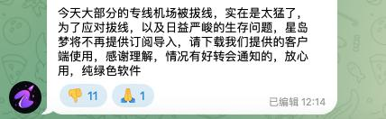
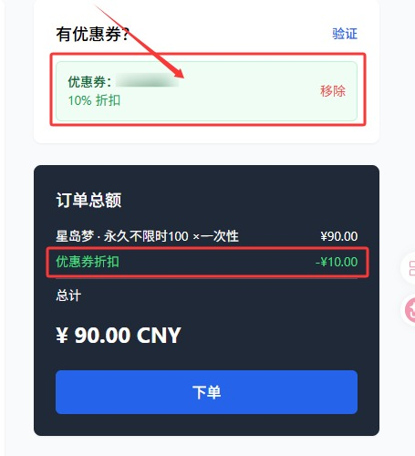
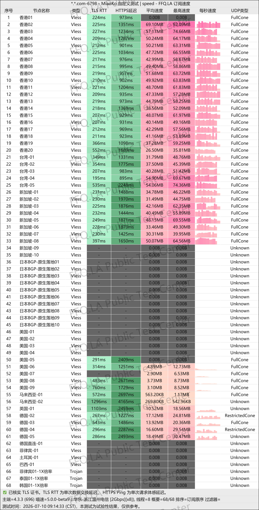
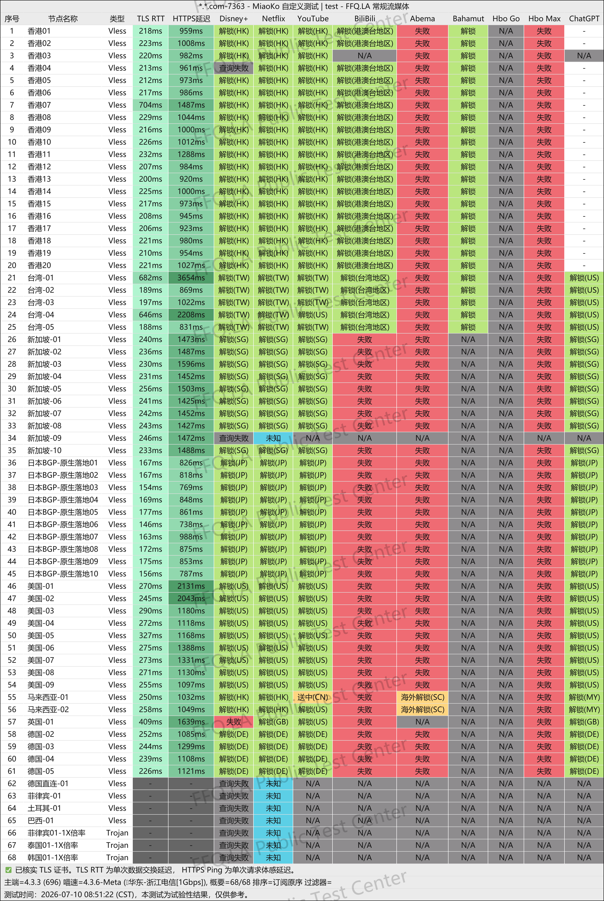
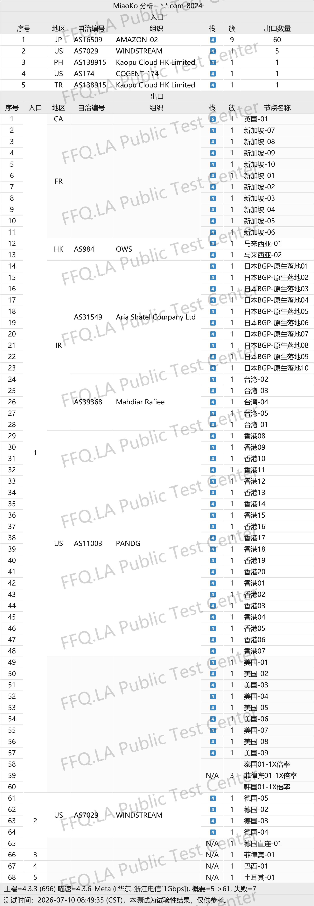

 🇨🇳 [中文](README.md) | 🇺🇸 [English](README_EN.md) | 🇷🇺 [Русский](README_RU.md) | 🇮🇷 فارسی

# وب‌سایت رسمی فیلترشکن XingDaoMeng (به‌روزرسانی: ۲ نوامبر ۲۰۲۶)

وب‌سایت رسمی فیلترشکن XingDaoMeng<br>
جدیدترین آدرس ۰۱: [awasdfeqr.xdmttt4.click](https://to.iix.im/xmd03)<br>
جدیدترین آدرس ۰۲: [wuyou202001.xdmvipaff.cc](https://to.iix.im/xdm02)<br>
آدرس رسمی: [vip.xingdaomeng.com](https://to.iix.im/xdm01)<br>

معرفی بهترین سرویس‌های VPN و اشتراک‌گذاری سرورهای پروکسی در سال ۲۰۲۶: [https://github.com/jdnei/JiChangTuiJian](https://github.com/jdnei/JiChangTuiJian)<br>

## انجمن تلگرامی VPN #AD

[گروه قرعه‌کشی VPN](https://331024.de/archives/choujiang) | [گروه گفت‌وگوی VPN](https://331024.de/archives/choujiang) | [گروه تست VPN](https://331024.de/archives/choujiang)<br>

[https://331024.de/archives/choujiang](https://331024.de/archives/choujiang)

## جدیدترین اطلاعیه

---



---

## کد دعوت

`برای استفاده از کد تخفیف هنگام خرید، ابتدا با این کد دعوت ثبت‌نام کنید.`

```bash
1snzCgTe
```

## کد تخفیف

`۱۰٪ تخفیف`

```bash
nmw888
```



## معرفی

XingDaoMeng یک سرویس VPN باکیفیت و مقرون‌به‌صرفه است که بر رفع محدودیت پلتفرم‌های پخش آنلاین تمرکز دارد.

این سرویس از مسیرهای انتقال پیشرفته و خطوط اختصاصی IPLC استفاده می‌کند و بر تأخیر پایین و پایداری بالای اتصال تأکید دارد.

XingDaoMeng طرح‌های اشتراک انعطاف‌پذیری ارائه می‌دهد و تعداد دستگاه‌های متصل را محدود نمی‌کند.

تمام سرورها از دسترسی به Netflix، Disney+، ChatGPT و سرویس‌های مشابه پشتیبانی می‌کنند؛ بنابراین برای تماشای فیلم و سریال و دورکاری روزمره مناسب است.

## مزایا

**زیرساخت شبکه پیشرفته:** استفاده از جدیدترین پروتکل VLESS و خطوط خصوصی IEPL در سطح سازمانی، همراه با بهینه‌سازی مسیرها برای China Telecom، China Unicom و China Mobile.

سیستم توزیع بار هوشمند می‌تواند بر اساس شرایط شبکه محلی کاربر، مناسب‌ترین مسیر اتصال را به‌صورت خودکار انتخاب کند.<br>

**رفع محدودیت سرویس‌های پخش آنلاین:** تمام مسیرها از دسترسی به Netflix، Disney+، سرویس‌های HBO و YouTube پشتیبانی می‌کنند. این سرویس برای حفظ پایداری اتصال در ساعات اوج شبانه، بدون کاهش سرعت و با امکان پخش روان ویدئوهای 4K طراحی شده است.<br>

**دسترسی به هوش مصنوعی و شبکه‌های اجتماعی:** پشتیبانی از ChatGPT، Gemini و سایر ابزارهای هوش مصنوعی و همچنین محیط ویدئوهای کوتاه و پخش زنده TikTok بین‌المللی.<br>

**پوشش جغرافیایی گسترده:** بیش از ۸۰ سرور در مناطق مختلف، از جمله هنگ‌کنگ، تایوان، ژاپن، سنگاپور، ایالات متحده، کره جنوبی، مالزی، تایلند، اندونزی، فیلیپین، ویتنام، بریتانیا، آلمان، فرانسه، ترکیه، برزیل و آرژانتین.<br>

**سازگاری با پلتفرم‌های مختلف:** پشتیبانی از iOS، Android، Windows، روترها و اتصال هم‌زمان چندین دستگاه.<br>

**پشتیبانی از کلاینت‌های محبوب:** سازگار با Shadowrocket، Clash، v2rayN، v2rayNG، Surge، Quantumult X، Stash و سایر برنامه‌های رایج پروکسی.<br>

**اتصالات سفارشی سازمانی:** ارائه خطوط اختصاصی متناسب با نیازهای کسب‌وکارها و کاربردهای تخصصی.<br>

**پشتیبانی انسانی:** ارائه خدمات پشتیبانی توسط کارشناسان برای کمک به کاربران تازه‌کار در راه‌اندازی و استفاده از سرویس.<br>

**پنل مدیریت اختصاصی:** استفاده از پنل توسعه‌یافته توسط خود مجموعه برای پیکربندی ساده و مدیریت آسان سرویس.<br>

## طرح‌های اشتراک

| طرح | قیمت | دوره پرداخت / نوع | ترافیک ماهانه / کل | قوانین ترافیک | پهنای باند شبکه | پشتیبانی از رفع محدودیت | دستگاه‌های هم‌زمان | پوشش سرورها | امکانات و قوانین اضافی |
|---|---:|---|---|---|---|---|---|---|---|
| **بسته سالانه اقتصادی (Starter Annual)** | ¥96.00 | سالانه | 60 گیگابایت در ماه | ضریب مصرف ۱ برابر برای تمام سرورها؛ بدون کاهش سرعت در ساعات اوج شبانه؛ بازنشانی خودکار هر ۳۰ روز | خطوط اختصاصی IPLC با تأخیر پایین؛ حداکثر سرعت هر سرور 2.5 گیگابیت بر ثانیه | IP بومی؛ پشتیبانی از Netflix، Disney+، ChatGPT، TikTok و سایر سرویس‌ها | بدون محدودیت تعداد کلاینت‌های هم‌زمان | هنگ‌کنگ ×20، تایوان ×10، ژاپن ×10، سنگاپور ×10، آمریکا ×10، کره جنوبی ×2، آرژانتین ×2، به‌علاوه مالزی، ویتنام، فیلیپین، تایلند، هند، آلمان، فرانسه، بریتانیا و سایر مناطق | مناسب کاربران کم‌مصرف و تازه‌کار؛ هزینه معادل حدود ¥8 در ماه؛ پاسخ‌گویی سریع پشتیبانی |
| **بسته 150 گیگابایتی (Extra 150 GB)** | ¥25.00 | ماهانه | 150 گیگابایت در ماه | ضریب مصرف ۱ برابر برای تمام سرورها؛ بدون کاهش سرعت در ساعات اوج شبانه؛ بازنشانی خودکار هر ۳۰ روز | خطوط اختصاصی IEPL با تأخیر پایین؛ حداکثر سرعت هر سرور 2.5 گیگابیت بر ثانیه | IP بومی؛ پشتیبانی از Netflix، Disney+، ChatGPT و TikTok | تعداد نامحدود دستگاه‌های هم‌زمان، شامل رایانه، تلفن همراه و روتر | هنگ‌کنگ ×20، تایوان ×5، ژاپن ×10، سنگاپور ×10، آمریکا ×10، مالزی ×2، به‌علاوه بریتانیا، فرانسه، آلمان، ترکیه، تایلند، برزیل و سایر مناطق | انتخاب هوشمند بهترین مسیر؛ ۲۰٪ تخفیف سالانه، ۳۰٪ تخفیف دوساله، ۴۰٪ تخفیف سه‌ساله |
| **بسته پیشرفته 300 گیگابایتی (Advanced 300 GB)** | ¥50.00 | ماهانه | 300 گیگابایت در ماه | ضریب مصرف ۱ برابر برای تمام سرورها؛ بدون کاهش سرعت در ساعات اوج شبانه؛ بازنشانی خودکار هر ۳۰ روز | خطوط اختصاصی IEPL با تأخیر پایین؛ حداکثر سرعت هر سرور 2.5 گیگابیت بر ثانیه | IP بومی؛ پشتیبانی از Netflix، Disney+، ChatGPT و TikTok | تعداد نامحدود دستگاه‌های هم‌زمان، شامل رایانه، تلفن همراه و روتر | هنگ‌کنگ ×20، تایوان ×5، ژاپن ×10، سنگاپور ×10، آمریکا ×10، مالزی ×2، به‌علاوه بریتانیا، فرانسه، آلمان، ترکیه، تایلند، برزیل و سایر مناطق | انتخاب هوشمند بهترین مسیر؛ ۲۰٪ تخفیف سالانه، ۳۰٪ تخفیف دوساله، ۴۰٪ تخفیف سه‌ساله |
| **بسته 500 گیگابایتی (Flash 500 GB)** | ¥70.00 | ماهانه | 500 گیگابایت در ماه | ضریب مصرف ۱ برابر برای تمام سرورها؛ بدون کاهش سرعت در ساعات اوج شبانه؛ بازنشانی خودکار هر ۳۰ روز | خطوط اختصاصی IEPL با تأخیر پایین؛ حداکثر سرعت هر سرور 2.5 گیگابیت بر ثانیه | IP بومی؛ پشتیبانی از Netflix، Disney+، ChatGPT و TikTok | تعداد نامحدود دستگاه‌های هم‌زمان، شامل رایانه، تلفن همراه و روتر | هنگ‌کنگ ×20، تایوان ×5، ژاپن ×10، سنگاپور ×10، آمریکا ×10، مالزی ×2، به‌علاوه بریتانیا، فرانسه، آلمان، ترکیه، تایلند، برزیل و سایر مناطق | انتخاب هوشمند بهترین مسیر؛ ۲۰٪ تخفیف سالانه، ۳۰٪ تخفیف دوساله، ۴۰٪ تخفیف سه‌ساله |
| **بسته پرچم‌دار 1 ترابایتی (Flagship 1 TB)** | ¥130.00 | ماهانه | 1.0 ترابایت در ماه | 1000 گیگابایت ترافیک پرسرعت در ماه؛ ضریب مصرف ۱ برابر برای تمام سرورها؛ بدون کاهش سرعت در ساعات اوج شبانه؛ بازنشانی خودکار هر ۳۰ روز | خطوط اختصاصی IEPL با تأخیر پایین؛ حداکثر سرعت هر سرور 2.5 گیگابیت بر ثانیه | IP بومی؛ پشتیبانی از Netflix، Disney+، ChatGPT و TikTok | تعداد نامحدود دستگاه‌های هم‌زمان، شامل رایانه، تلفن همراه و روتر | هنگ‌کنگ ×20، تایوان ×5، ژاپن ×10، سنگاپور ×10، آمریکا ×10، مالزی ×2، به‌علاوه بریتانیا، فرانسه، آلمان، ترکیه، تایلند، برزیل و سایر مناطق | انتخاب هوشمند بهترین مسیر؛ ۲۰٪ تخفیف سالانه، ۳۰٪ تخفیف دوساله، ۴۰٪ تخفیف سه‌ساله |
| **100 گیگابایت بدون محدودیت زمانی** | ¥100.00 | یک‌بار پرداخت | مجموعاً 100 گیگابایت | ضریب مصرف ۱ برابر برای تمام سرورها؛ بدون کاهش سرعت در ساعات اوج شبانه؛ بدون بازنشانی خودکار پس از خرید | خطوط اختصاصی IPLC؛ حداکثر سرعت 2.5 گیگابیت بر ثانیه | IP بومی؛ پشتیبانی از سرویس‌های اصلی پخش آنلاین، ChatGPT و TikTok | بدون محدودیت تعداد کلاینت‌های هم‌زمان | هنگ‌کنگ ×20، تایوان ×5، ژاپن ×10، سنگاپور ×10، آمریکا ×10، مالزی ×2، به‌علاوه بریتانیا، فرانسه، آلمان، ترکیه، تایلند، برزیل و سایر مناطق | امکان بازنشانی دستی ترافیک با پرداخت ۹۰٪ قیمت اولیه (¥90)؛ تخفیف‌های سالانه و بلندمدت اعمال نمی‌شوند |
| **300 گیگابایت بدون محدودیت زمانی** | ¥300.00 | یک‌بار پرداخت | مجموعاً 300 گیگابایت | ضریب مصرف ۱ برابر برای تمام سرورها؛ بدون کاهش سرعت در ساعات اوج شبانه؛ بدون بازنشانی خودکار پس از خرید | خطوط اختصاصی IPLC؛ حداکثر سرعت 2.5 گیگابیت بر ثانیه | IP بومی؛ پشتیبانی از سرویس‌های اصلی پخش آنلاین، ChatGPT و TikTok | بدون محدودیت تعداد کلاینت‌های هم‌زمان | هنگ‌کنگ ×20، تایوان ×5، ژاپن ×10، سنگاپور ×10، آمریکا ×10، مالزی ×2، به‌علاوه بریتانیا، فرانسه، آلمان، ترکیه، تایلند، برزیل و سایر مناطق | امکان بازنشانی دستی ترافیک با پرداخت ۹۰٪ قیمت اولیه (¥270)؛ تخفیف‌های سالانه و بلندمدت اعمال نمی‌شوند |
| **1 ترابایت بدون محدودیت زمانی** | ¥600.00 | یک‌بار پرداخت | مجموعاً 1.0 ترابایت | ضریب مصرف ۱ برابر برای تمام سرورها؛ بدون کاهش سرعت در ساعات اوج شبانه؛ بدون بازنشانی خودکار پس از خرید | خطوط اختصاصی IPLC؛ حداکثر سرعت 2.5 گیگابیت بر ثانیه | IP بومی؛ پشتیبانی از سرویس‌های اصلی پخش آنلاین، ChatGPT و TikTok | بدون محدودیت تعداد کلاینت‌های هم‌زمان | هنگ‌کنگ ×20، تایوان ×5، ژاپن ×10، سنگاپور ×10، آمریکا ×10، مالزی ×2، به‌علاوه بریتانیا، فرانسه، آلمان، ترکیه، تایلند، برزیل و سایر مناطق | امکان بازنشانی دستی ترافیک با پرداخت ۹۰٪ قیمت اولیه (¥540)؛ تخفیف‌های سالانه و بلندمدت اعمال نمی‌شوند |
| **طرح سفارشی (Custom Plan)** | ¥680.00 | ماهانه | 500 گیگابایت | سرور اختصاصی بر اساس نیاز کاربر؛ امکان سفارشی‌سازی ترافیک، پهنای باند و مسیرهای شبکه | اتصال کاملاً اختصاصی IPLC با پهنای باند مستقل، تأخیر بسیار پایین و پایداری بالا | IP بومی اختصاصی برای تجارت الکترونیک، پخش زنده و کاربردهای سازمانی | تعداد نامحدود کلاینت و امکان اتصال هم‌زمان چندین دستگاه | موقعیت‌های سفارشی شامل هنگ‌کنگ، ژاپن، آمریکا، سنگاپور و سایر مناطق | مناسب تجارت الکترونیک بین‌المللی و پخش زنده TikTok؛ پشتیبانی فنی اختصاصی و اولویت در خدمات مشتریان؛ قیمت نهایی بر اساس تنظیمات متفاوت است |

## 📊 آزمایش عملکرد و تحلیل

#### ۱. آزمایش سرعت در ساعات اوج مصرف شبانه



#### ۲. گزارش رفع محدودیت سرویس‌های پخش آنلاین



#### ۳. تحلیل سرورهای ورودی و خروجی


