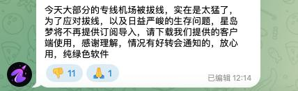
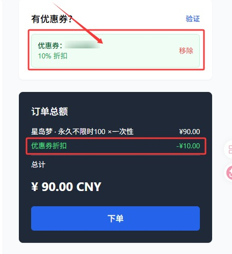
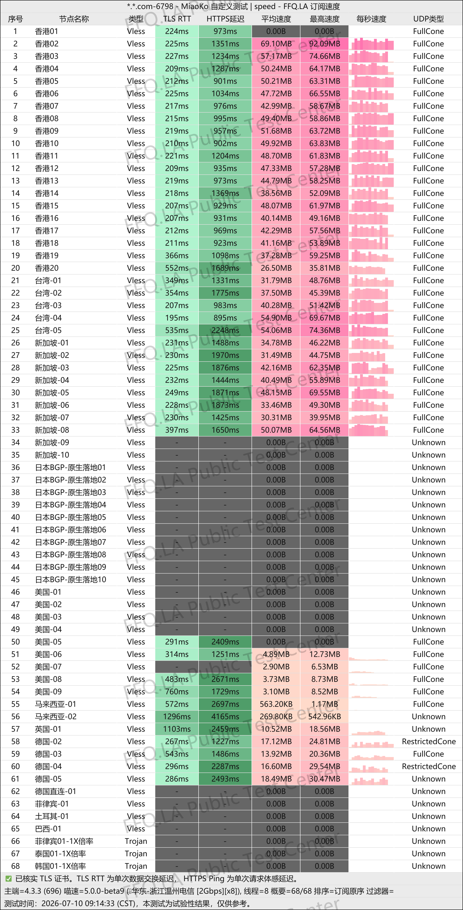
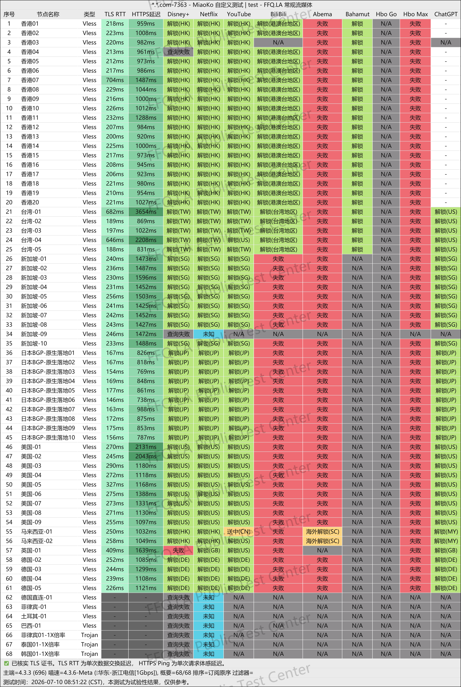
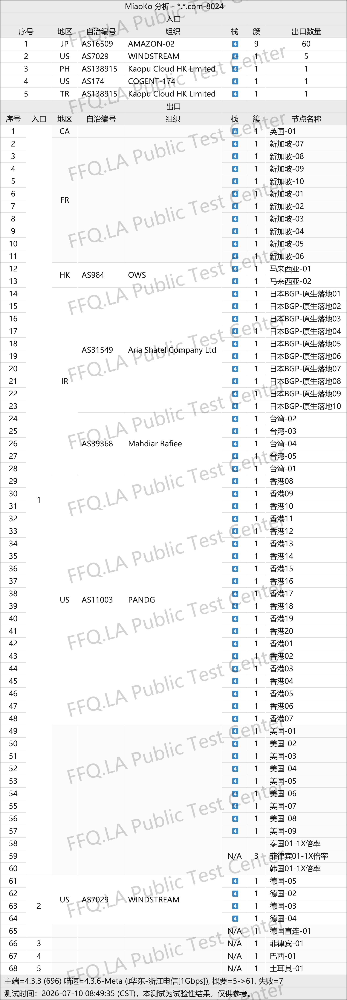

🇨🇳 [中文](README.md) | 🇺🇸 [English](README_EN.md) | 🇷🇺 Русский | 🇮🇷 [فارسی](README_FA.md)

# Официальный сайт XingDaoMeng VPN (обновлено 8 ноября 2026)

Официальный сайт XingDaoMeng VPN<br>
Новый адрес 01: [awasdfeqr.xdmttt4.click](https://to.iix.im/xmd03)<br>
Новый адрес 02: [wuyou202001.xdmvipaff.cc](https://to.iix.im/xdm02)<br>
Официальный сайт: [vip.xingdaomeng.com](https://to.iix.im/xdm01)<br>

Лучшие VPN-сервисы и прокси-серверы 2026 года: [https://github.com/jdnei/JiChangTuiJian](https://github.com/jdnei/JiChangTuiJian)<br>

## Telegram-сообщество VPN #AD

[Группа розыгрышей VPN](https://331024.de/archives/choujiang) | [Чат VPN](https://331024.de/archives/choujiang) | [Группа тестирования VPN](https://331024.de/archives/choujiang)<br>

[https://331024.de/archives/choujiang](https://331024.de/archives/choujiang)

## Последнее объявление

---



---

## Пригласительный код

`Зарегистрируйтесь с этим пригласительным кодом, чтобы получить возможность оформить заказ с промокодом.`

```bash
1snzCgTe
```

## Промокод / Код скидки

`Скидка 10%`

```bash
nmw888
```



## Описание

XingDaoMeng — доступный премиальный VPN-сервис, ориентированный на разблокировку стриминговых платформ.

Он сочетает качественные транзитные соединения и выделенные линии IPLC, уделяя особое внимание низкой задержке и высокой стабильности сети.

Сервис предлагает гибкие тарифные планы без ограничений по количеству устройств.

Все серверы поддерживают доступ к Netflix, Disney+, ChatGPT и другим популярным сервисам. XingDaoMeng подходит для просмотра фильмов и сериалов, а также повседневной удалённой работы.

## Преимущества

**Современная сетевая инфраструктура:** Использование новейшего протокола VLESS и частных выделенных линий IEPL корпоративного уровня с оптимизацией для China Telecom, China Unicom и China Mobile.

Интеллектуальная балансировка нагрузки автоматически выбирает подходящий маршрут с учётом сетевых условий пользователя.<br>

**Разблокировка стриминговых платформ:** Все маршруты поддерживают Netflix, Disney+, сервисы HBO и YouTube. Сеть рассчитана на стабильную работу без ограничения скорости в вечерние часы пик и плавное воспроизведение видео в формате 4K.<br>

**Доступ к ИИ и социальным платформам:** Поддержка ChatGPT, Gemini и других инструментов искусственного интеллекта, а также международной версии TikTok, коротких видео и прямых трансляций.<br>

**Широкое географическое покрытие:** Более 80 серверов в различных регионах, включая Гонконг, Тайвань, Японию, Сингапур, США, Южную Корею, Малайзию, Таиланд, Индонезию, Филиппины, Вьетнам, Великобританию, Германию, Францию, Турцию, Бразилию и Аргентину.<br>

**Совместимость с различными платформами:** Поддержка iOS, Android, Windows, маршрутизаторов и одновременного подключения нескольких устройств.<br>

**Поддержка популярных прокси-клиентов:** Совместимость с Shadowrocket, Clash, v2rayN, v2rayNG, Surge, Quantumult X, Stash и другими распространёнными приложениями.<br>

**Индивидуальные корпоративные подключения:** Возможность настройки выделенных каналов под конкретные задачи бизнеса.<br>

**Помощь специалистов:** Служба поддержки с живыми операторами помогает начинающим пользователям настроить подключение.<br>

**Собственная панель управления:** Независимо разработанная панель обеспечивает простую настройку и удобное управление сервисом.<br>

## Тарифные планы

| Тариф | Цена | Период оплаты / Тип | Месячный / Общий трафик | Правила расхода трафика | Пропускная способность | Разблокировка сервисов | Одновременные устройства | География серверов | Дополнительные возможности / Правила |
|---|---:|---|---|---|---|---|---|---|---|
| **Начальный годовой тариф (Starter Annual)** | ¥96.00 | Ежегодно | 60 ГБ/мес. | Коэффициент расхода 1× на всех серверах; без ограничения скорости вечером; автоматическое обновление каждые 30 дней | Выделенные линии IPLC с низкой задержкой; пиковая скорость одного сервера до 2.5 Гбит/с | Нативные IP; поддержка Netflix, Disney+, ChatGPT, TikTok и других сервисов | Без ограничений | Гонконг ×20, Тайвань ×10, Япония ×10, Сингапур ×10, США ×10, Южная Корея ×2, Аргентина ×2, а также Малайзия, Вьетнам, Филиппины, Таиланд, Индия, Германия, Франция, Великобритания и другие регионы | Подходит новичкам и пользователям с небольшим расходом трафика; около ¥8/мес. при годовой оплате; оперативная поддержка |
| **Дополнительный 150 ГБ (Extra 150 GB)** | ¥25.00 | Ежемесячно | 150 ГБ/мес. | Коэффициент расхода 1× на всех серверах; без снижения скорости вечером; автоматическое обновление каждые 30 дней | Выделенные линии IEPL с низкой задержкой; пиковая скорость одного сервера до 2.5 Гбит/с | Нативные IP; поддержка Netflix, Disney+, ChatGPT и TikTok | Неограниченное количество одновременно подключённых компьютеров, смартфонов и маршрутизаторов | Гонконг ×20, Тайвань ×5, Япония ×10, Сингапур ×10, США ×10, Малайзия ×2, а также Великобритания, Франция, Германия, Турция, Таиланд, Бразилия и другие регионы | Интеллектуальный выбор маршрута; скидка 20% на годовую подписку, 30% на двухлетнюю, 40% на трёхлетнюю |
| **Продвинутый 300 ГБ (Advanced 300 GB)** | ¥50.00 | Ежемесячно | 300 ГБ/мес. | Коэффициент расхода 1× на всех серверах; без снижения скорости вечером; автоматическое обновление каждые 30 дней | Выделенные линии IEPL с низкой задержкой; пиковая скорость одного сервера до 2.5 Гбит/с | Нативные IP; поддержка Netflix, Disney+, ChatGPT и TikTok | Неограниченное количество одновременно подключённых компьютеров, смартфонов и маршрутизаторов | Гонконг ×20, Тайвань ×5, Япония ×10, Сингапур ×10, США ×10, Малайзия ×2, а также Великобритания, Франция, Германия, Турция, Таиланд, Бразилия и другие регионы | Интеллектуальный выбор маршрута; скидка 20% на годовую подписку, 30% на двухлетнюю, 40% на трёхлетнюю |
| **Яркий 500 ГБ (Flash 500 GB)** | ¥70.00 | Ежемесячно | 500 ГБ/мес. | Коэффициент расхода 1× на всех серверах; без снижения скорости вечером; автоматическое обновление каждые 30 дней | Выделенные линии IEPL с низкой задержкой; пиковая скорость одного сервера до 2.5 Гбит/с | Нативные IP; поддержка Netflix, Disney+, ChatGPT и TikTok | Неограниченное количество одновременно подключённых компьютеров, смартфонов и маршрутизаторов | Гонконг ×20, Тайвань ×5, Япония ×10, Сингапур ×10, США ×10, Малайзия ×2, а также Великобритания, Франция, Германия, Турция, Таиланд, Бразилия и другие регионы | Интеллектуальный выбор маршрута; скидка 20% на годовую подписку, 30% на двухлетнюю, 40% на трёхлетнюю |
| **Флагманский 1 ТБ (Flagship 1 TB)** | ¥130.00 | Ежемесячно | 1.0 ТБ/мес. | 1000 ГБ высокоскоростного трафика в месяц; коэффициент расхода 1×; без снижения скорости вечером; автоматическое обновление каждые 30 дней | Выделенные линии IEPL с низкой задержкой; пиковая скорость одного сервера до 2.5 Гбит/с | Нативные IP; поддержка Netflix, Disney+, ChatGPT и TikTok | Неограниченное количество одновременно подключённых компьютеров, смартфонов и маршрутизаторов | Гонконг ×20, Тайвань ×5, Япония ×10, Сингапур ×10, США ×10, Малайзия ×2, а также Великобритания, Франция, Германия, Турция, Таиланд, Бразилия и другие регионы | Интеллектуальный выбор маршрута; скидка 20% на годовую подписку, 30% на двухлетнюю, 40% на трёхлетнюю |
| **100 ГБ без ограничения срока** | ¥100.00 | Единовременно | Всего 100 ГБ | Коэффициент расхода 1× на всех серверах; без вечерних ограничений скорости; после покупки трафик автоматически не обновляется | Выделенные линии IPLC; максимальная скорость до 2.5 Гбит/с | Нативные IP; доступ к основным стриминговым платформам, ChatGPT и TikTok | Без ограничений | Гонконг ×20, Тайвань ×5, Япония ×10, Сингапур ×10, США ×10, Малайзия ×2, а также Великобритания, Франция, Германия, Турция, Таиланд, Бразилия и другие регионы | Ручное обновление трафика за 90% первоначальной цены (¥90); скидки на годовые и долгосрочные подписки не применяются |
| **300 ГБ без ограничения срока** | ¥300.00 | Единовременно | Всего 300 ГБ | Коэффициент расхода 1× на всех серверах; без вечерних ограничений скорости; после покупки трафик автоматически не обновляется | Выделенные линии IPLC; максимальная скорость до 2.5 Гбит/с | Нативные IP; доступ к основным стриминговым платформам, ChatGPT и TikTok | Без ограничений | Гонконг ×20, Тайвань ×5, Япония ×10, Сингапур ×10, США ×10, Малайзия ×2, а также Великобритания, Франция, Германия, Турция, Таиланд, Бразилия и другие регионы | Ручное обновление трафика за 90% первоначальной цены (¥270); скидки на годовые и долгосрочные подписки не применяются |
| **1 ТБ без ограничения срока** | ¥600.00 | Единовременно | Всего 1.0 ТБ | Коэффициент расхода 1× на всех серверах; без вечерних ограничений скорости; после покупки трафик автоматически не обновляется | Выделенные линии IPLC; максимальная скорость до 2.5 Гбит/с | Нативные IP; доступ к основным стриминговым платформам, ChatGPT и TikTok | Без ограничений | Гонконг ×20, Тайвань ×5, Япония ×10, Сингапур ×10, США ×10, Малайзия ×2, а также Великобритания, Франция, Германия, Турция, Таиланд, Бразилия и другие регионы | Ручное обновление трафика за 90% первоначальной цены (¥540); скидки на годовые и долгосрочные подписки не применяются |
| **Индивидуальный тариф (Custom Plan)** | ¥680.00 | Ежемесячно | 500 ГБ | Выделенные узлы развёртываются под потребности клиента; можно настроить объём трафика, пропускную способность и маршруты | Полностью выделенные линии IPLC с индивидуальной пропускной способностью, минимальной задержкой и высокой стабильностью | Эксклюзивные нативные IP-адреса для электронной коммерции, прямых трансляций и корпоративных приложений | Без ограничений по количеству клиентов и устройств | Индивидуальный выбор регионов, включая Гонконг, Японию, США, Сингапур и другие страны | Подходит для международной электронной коммерции и трансляций TikTok; персональная техническая поддержка и приоритетное обслуживание; окончательная стоимость зависит от конфигурации |

## 📊 Тестирование производительности и анализ

#### 1. Тест скорости в вечерние часы пик



#### 2. Отчёт о разблокировке стриминговых сервисов



#### 3. Анализ входных и выходных узлов


